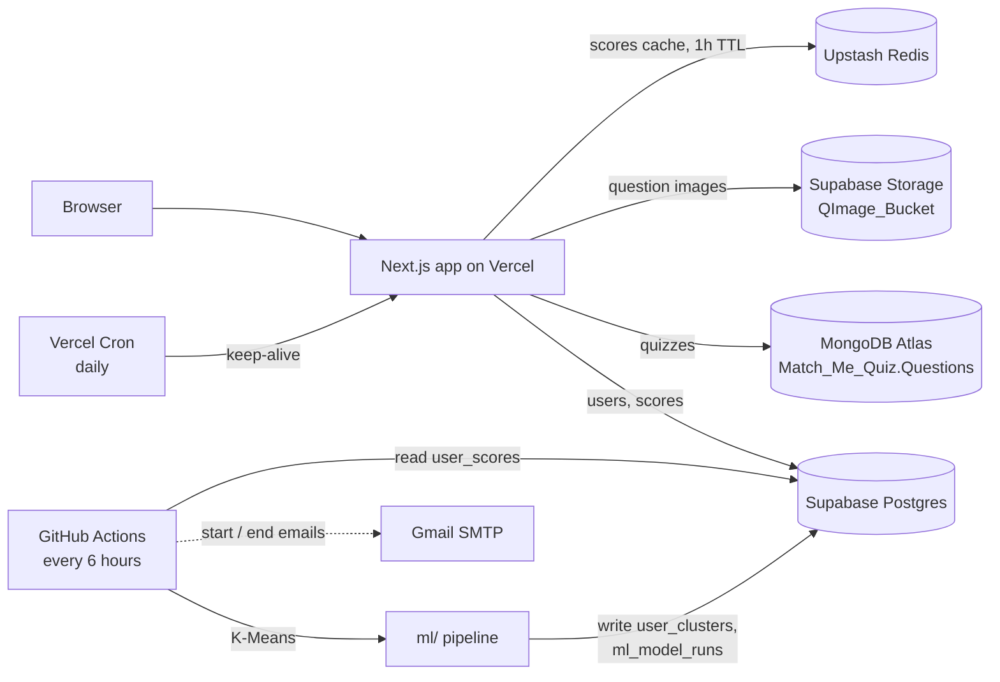

<h1 align="center">
  
</h1>

<p align="center"><b>Find people with the same vibe.</b></p>

MatchKARO is a quiz-based matching app. Users create multiple-choice quizzes, take each other's quizzes, and get scored. A scheduled machine-learning job then groups users with similar quiz-score profiles into clusters, which is the foundation for matching people who think alike.

Built with **Next.js**, **MongoDB Atlas**, **Supabase**, **Upstash Redis**, and a **scikit-learn** K-Means pipeline that runs on **GitHub Actions**.

---

## Features

- **Accounts**: register and log in with a hashed password (bcrypt) and a JWT stored in an `httpOnly` cookie.
- **Quiz maker**: build a quiz with any number of questions, four options (A-D), a correct answer, and an optional image per question (JPEG/PNG/WebP, max 2 MB).
- **Quiz browser**: list all quizzes, newest first, with live search by name.
- **Quiz taker**: 2-minute countdown, select or deselect answers, and auto-submit when time runs out.
- **Server-side scoring**: correct answers are never sent to the browser. The server grades the submission and stores the score as a fraction (0 to 1).
- **Score dashboard**: each user sees their latest score per quiz, cached in Redis for fast reloads.
- **Automatic clustering**: every 6 hours, a K-Means model groups users by their score profiles and saves the results back to Supabase.
- **Run notifications**: an email is sent when each training run starts and finishes.
- **Keep-alive cron**: a daily Vercel cron pings MongoDB and Supabase Storage so free-tier projects don't go idle.

---

## Tech stack

| Layer | Technology |
| --- | --- |
| Frontend | Next.js 16 (App Router), React 19 with React Compiler, Tailwind CSS 4, react-icons |
| Backend | Next.js Route Handlers (`src/app/api`) |
| Quiz data | MongoDB Atlas (`mongodb` driver) |
| Users, scores, ML output, images | Supabase (Postgres + Storage) |
| Cache | Upstash Redis (REST) |
| Auth | `bcryptjs`, `jsonwebtoken`, `httpOnly` cookie |
| ML | Python 3.11, pandas, scikit-learn, supabase-py |
| CI / scheduling | GitHub Actions (training), Vercel Cron (keep-alive) |
| Hosting / analytics | Vercel, Vercel Analytics |

---

## Architecture



### Where each piece of data lives

| Data | Store | Details |
| --- | --- | --- |
| Quizzes and questions | MongoDB | Database `Match_Me_Quiz`, collection `Questions` |
| Question images | Supabase Storage | Public bucket `QImage_Bucket`, file name `<quizName>_<questionNumber>` |
| User accounts | Supabase | Table `login_pass_table` |
| Quiz scores | Supabase | Table `user_scores` (one row per user and quiz) |
| Cluster assignments | Supabase | Table `user_clusters` |
| Training run history | Supabase | Table `ml_model_runs` |
| Cached scores | Redis | Key `scores:<username>`, 1 hour TTL |

---

## Data model

### MongoDB: `Match_Me_Quiz.Questions`

```jsonc
{
  "quizName": "string",
  "questions": [
    {
      "Question": "string",
      "optionA": "string",
      "optionB": "string",
      "optionC": "string",
      "optionD": "string",
      "correct": "A | B | C | D",
      "imageUrl": "string (optional, public Supabase URL)"
    }
  ],
  "createdAt": "Date",
  "createdBy": "string"
}
```

### Supabase tables

| Table | Columns used by the code |
| --- | --- |
| `login_pass_table` | `username`, `hpass`, `email`, `autho` |
| `user_scores` | `username`, `quizname`, `score`, `created_at`, with a unique constraint on (`username`, `quizname`) |
| `user_clusters` | `username` (unique), `cluster_id`, `model_run_id`, `updated_at` |
| `ml_model_runs` | `id`, `best_k`, `silhouette_score`, `total_users`, `status` (`running` / `success`) |

Storage bucket: `QImage_Bucket` (public).

---

## API routes

| Method | Route | Purpose |
| --- | --- | --- |
| `POST` | `/api/auth/register` | Create an account (password hashed with bcrypt) |
| `POST` | `/api/auth/login` | Verify credentials and set the auth cookie |
| `POST` | `/api/auth/logout` | Clear the auth cookie |
| `GET` | `/api/auth/cook_status` | Return the current user, or 401 if not logged in |
| `GET` | `/api/fetchQuestion` | List all quizzes (name and creator only), newest first |
| `GET` | `/api/fetchQuiz?quizName=` | Fetch one quiz **without** the correct answers |
| `POST` | `/api/fetchQuiz` | Submit answers, grade on the server, upsert the score, clear the Redis cache |
| `POST` | `/api/makeQuestion` | Create a quiz (multipart form): upload images to Supabase Storage, then insert into MongoDB |
| `GET` | `/api/scores` | Current user's scores, served from Redis when cached |
| `GET` | `/api/keepAlive` | Cron-only health ping for MongoDB and Supabase; requires `Authorization: Bearer <CRON_SECRET>` |

---

## The ML pipeline

Code lives in [`ml/`](./ml) and runs as `python -m ml.train`.

1. **Fetch** (`fetch_data.py`): pulls every row of `user_scores` from Supabase, 1000 rows per page.
2. **Preprocess** (`preprocessing.py`):
   - keeps only each user's latest attempt per quiz
   - pivots the data into a user x quiz score matrix
   - fills quizzes a user hasn't taken with that quiz's median score
3. **Cluster** (`clustering.py`):
   - standardizes the features with `StandardScaler`
   - tries K-Means for every K from 2 to `min(8, users - 1, distinct profiles - 1)`
   - keeps the K with the best **silhouette score**
4. **Save** (`train.py`): records the run in `ml_model_runs`, upserts each user's cluster into `user_clusters` in batches of 500, then marks the run `success`.

### Automation

`.github/workflows/train-model.yml` runs the pipeline **every 6 hours** and can also be started manually from the Actions tab. It sends a "started" and an "ended" email (via Gmail SMTP) containing the run status and a link to the run.

---

## Project structure

```
match_me/
├── .github/workflows/
│   └── train-model.yml        # ML training every 6 hours
├── ml/
│   ├── fetch_data.py          # read scores from Supabase
│   ├── preprocessing.py       # user x quiz feature matrix
│   ├── clustering.py          # K-Means + silhouette selection
│   ├── train.py               # pipeline entry point, saves results
│   ├── send_email.py          # start / end notifications
│   └── test_*.py              # smoke scripts (run against live data)
├── src/
│   ├── app/
│   │   ├── page.js            # animated splash, redirects to /home
│   │   ├── home/              # quiz list, search, user scores
│   │   ├── loginPage/         # register / login
│   │   ├── questionMake/      # quiz creation portal
│   │   ├── quizTake/          # timed quiz page
│   │   └── api/               # route handlers (auth, quizzes, scores, keepAlive)
│   ├── lib/
│   │   ├── mongodb.js         # cached MongoDB client
│   │   ├── supabase.js        # Supabase client
│   │   ├── redis.js           # Upstash Redis client
│   │   └── getUser.js         # reads and verifies the JWT cookie
│   └── styles/
├── banner.gif                 # animated pixel-art logo
├── requirements.txt           # Python dependencies for ml/
├── vercel.json                # cron schedule
└── package.json
```

---

## Roadmap

- **Find People**: the section exists on the home page; the next step is to surface users from the same cluster.
- **Profile page**: linked from the home page when logged in.
- **Email verification**: registration currently trusts the supplied email.
- **Quiz descriptions** on the quiz detail card.

---

## Author
**Abhishek Singh**, [@VickZeus](https://github.com/VickZeus)
